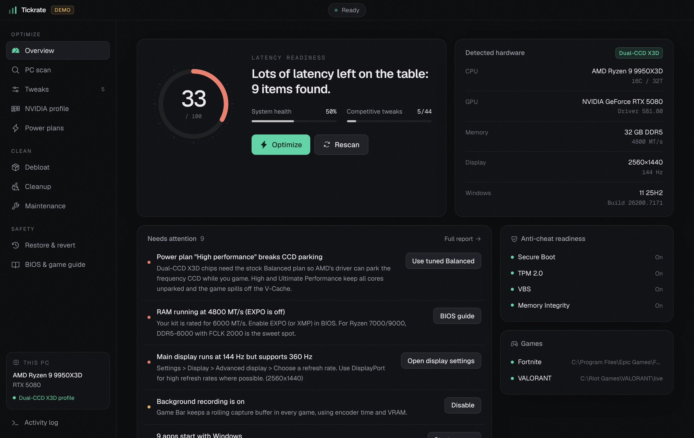
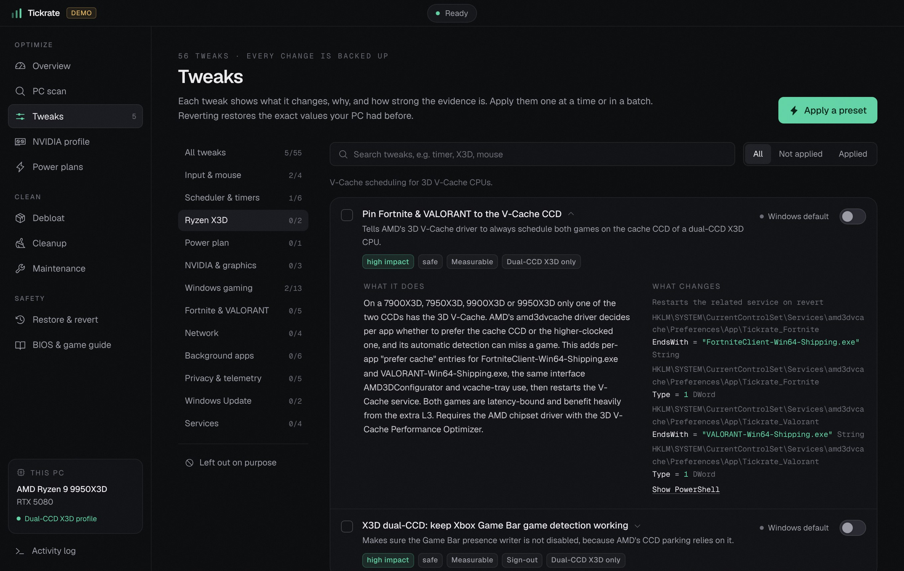

<p align="center">
  
</p>

<h1 align="center">Tickrate</h1>

<p align="center">
  A Windows optimizer with one job: lower input latency and steadier frame times in <b>Fortnite</b> and <b>VALORANT</b>.<br/>
  Tuned for <b>NVIDIA GeForce/RTX</b> GPUs and <b>AMD Ryzen X3D</b> CPUs. Every change is explained, backed up and reversible.
</p>

<p align="center">
  
</p>

## What it does

| | |
|---|---|
| **PC scan** | Detects your CPU type (dual-CCD X3D, single-CCD X3D, other), GPU, driver age, PCIe link width, Resizable BAR, RAM speed (EXPO/XMP off?), single-channel memory, monitors running below their max refresh rate, forced HPET, power plan, Game Mode, Secure Boot / TPM / VBS / HVCI (anti-cheat readiness), BitLocker, startup load and known background hogs. Each finding comes with a one-click fix or a guide. |
| **56 tweaks in 12 categories** | Input, scheduler and timers, Ryzen X3D, power, NVIDIA, Windows gaming features, per-game (Fortnite & VALORANT), network, background apps, privacy and telemetry, Windows Update and services. Each one has a plain-language description, an impact / risk / evidence rating, and the exact registry values, services, tasks or scripts it changes. |
| **Presets** | *Essential* (safe, proven), *Competitive* (adds small, documented trade-offs) and *Everything* (adds situational tweaks). Tweaks that don't fit your CPU are skipped automatically. |
| **NVIDIA Profile Inspector** | Downloads the official [Orbmu2k/nvidiaProfileInspector](https://github.com/Orbmu2k/nvidiaProfileInspector) release on first use. It exports your current driver profile as a backup, merge-imports the Tickrate settings into the Base Profile (power management, low-latency mode, unlimited shader cache, texture filtering, V-Sync per monitor type, preferred refresh rate), then reads the profile back to verify. It can restore the original in one click. |
| **Power plans** | Ryzen X3D-aware (see below). |
| **Debloat** | Removes promotional and unused Store apps. Xbox Game Bar, Gaming Services, the Store and shared frameworks are protected. Includes a startup-app manager that works like Task Manager's (reversible). |
| **Cleanup** | Measures, then clears temp files, the Windows Update cache, the Delivery Optimization cache, crash dumps, error reports, Fortnite/VALORANT/Riot/Epic logs and caches, old servicing logs, thumbnails, the recycle bin, and NVIDIA/DirectX shader caches (opt-in). |
| **Maintenance** | TRIM / optimize drives, DNS flush, DISM component cleanup, SFC, DISM RestoreHealth, Explorer restart and network-stack reset, with live output. |
| **Restore & revert** | Automatic System Restore point before the first change of each session, a manual restore-point creator, a list of everything Tickrate changed with per-item and "revert everything" buttons, and a list of removed apps with Store links. |
| **BIOS & game guide** | EXPO, Curve Optimizer, CPPC and dynamic preferred cores, Re-BAR, fTPM/Secure Boot, recommended in-game settings for both games, mouse and monitor setup, and how to measure results (FrameView, CapFrameX, LatencyMon). |

<p align="center">
  
</p>

## Built for Ryzen X3D

The most important decisions in Tickrate depend on which X3D chip you have:

- **Dual-CCD X3D** (7900X3D, 7950X3D, 9900X3D, 9950X3D). Only one CCD has the 3D V-Cache, and AMD's `amd3dvcache` driver parks the other one while you game. That **only works with the Balanced power plan, Game Mode on and Xbox Game Bar installed**. Most "gaming" optimizers switch to Ultimate Performance and remove Game Bar, which breaks the parking. Tickrate instead:
  - keeps the stock Balanced plan and only removes USB, PCIe, disk and Wi-Fi power saving, leaving processor settings untouched;
  - pins `FortniteClient-Win64-Shipping.exe` and `VALORANT-Win64-Shipping.exe` to the V-Cache CCD through the driver's per-app preference interface (the same one AMD3DConfigurator and vcache-tray use);
  - un-breaks Game Bar game detection if another tool disabled it.
- **Single-CCD X3D** (5800X3D, 5700X3D, 7800X3D, 9800X3D) **and other CPUs** get the *Tickrate Low Latency* plan: core parking off, minimum state 100%, EPP 0, aggressive boost, no USB or PCIe power saving. C-states stay on, because hotter X3D chips boost lower.

The engine detects the CPU itself and refuses CPU-specific tweaks on the wrong CPU, even if the UI asked for them.

## Left out on purpose

Tickrate deliberately does **not** do these, even though other optimizers do (full reasoning in [docs/TWEAKS.md](docs/TWEAKS.md#left-out-on-purpose)):

- **Disabling VBS / Memory Integrity (HVCI)**. VALORANT's Vanguard On-Demand (2026) needs VBS + HVCI + IOMMU + TPM + Secure Boot, and Fortnite PC tournaments check Secure Boot / TPM / IOMMU.
- Disabling Spectre/Meltdown mitigations, DEP, driver signing or test-signing.
- Forcing HPET (`useplatformclock`). Tickrate *removes* that flag if it finds it.
- Disabling C-states, Ultimate Performance on dual-CCD X3D, or uninstalling Game Bar.
- Nagle / TCP tweaks (both games use UDP), mouse queue sizes, GPU IRQ priority, `DisableDynamicPstate`, disabling the page file, Realtime priority.

## Safety model

- **Per-value backups.** Before any change, the engine records the original value of every registry value, service start type, scheduled-task state, boot setting and power-plan setting it touches, in `%ProgramData%\Tickrate\state.json`. Reverting writes those exact values back, and deletes keys Tickrate created.
- **System Restore point** before the first change of each session (it can be turned off). System Protection is enabled for the system drive if it was off.
- **No arbitrary code from the UI.** The renderer only sends tweak IDs. The main process resolves them against the bundled catalog, so nothing outside the reviewed catalog can be executed.
- **Anti-cheat friendly.** Nothing is injected into a game process. Per-game priority uses Windows' own launch options (`PerfOptions`), the same mechanism Task Manager-style tools use.
- **Transparent.** Every action is streamed to the in-app activity log and written to `%ProgramData%\Tickrate\logs`.
- **Tested on real Windows.** CI applies and reverts every tweak on a disposable Windows VM and checks that each original value comes back byte-for-byte ([`tests/engine.roundtrip.ps1`](tests/engine.roundtrip.ps1)).

> Tickrate changes system settings and needs to run as administrator. Read what a tweak does before applying it, especially the ones marked *moderate* or *advanced*.

## Running from source

Requires Windows 10/11, Node.js 22+ and an **elevated** terminal (the engine writes to HKLM, services and boot config).

```bash
npm ci
```

```bash
npm run dev
```

On macOS/Linux, or in a plain browser (`npm run dev:web`), the UI runs in **demo mode** with sample data and touches nothing.

Build the Windows installer and portable exe into `release/`:

```bash
npm run dist
```

## Project layout

```
electron/            Electron main process
  main.cjs           window, IPC, auto restore point, settings
  engine.cjs         runs the PowerShell engine, streams its log
  catalog/           every tweak, NVIDIA setting, cleanup target and debloat app (the single source of truth)
engine/              Windows PowerShell 5.1 engine (no dependencies)
  Engine.ps1         request dispatcher
  lib/Tweaks.ps1     detect / apply / revert with per-value backups
  lib/Scan.ps1       hardware & settings scanner
  lib/Nvidia.ps1     NVIDIA Profile Inspector integration
  lib/Cleanup.ps1, System.ps1, Games.ps1, Registry.ps1
src/                 React UI (Vite, Tailwind v4, Framer Motion, Phosphor icons)
tests/               catalog tests (Node) and the Windows round-trip test (PowerShell)
docs/TWEAKS.md       generated reference for every tweak: npm run docs
```

## Tests & CI

- `npm test` validates the catalog: IDs, ratings, preset consistency, op schemas, and that every embedded PowerShell snippet parses.
- `npm run typecheck` and `npm run build:renderer` check the UI.
- GitHub Actions also runs the Windows engine round-trip test and builds an unsigned installer as a workflow artifact.

## Releases

Push a version tag (`npm version patch && git push --follow-tags`) and `.github/workflows/release.yml` builds the NSIS installer and portable exe and attaches them to a draft GitHub Release.

## Credits

- UI design follows the [Taste Skill](https://github.com/Leonxlnx/taste-skill) (`design-taste-frontend`, MIT), vendored in `.claude/skills/`: Geist + Geist Mono, zinc neutrals with a single desaturated accent, no glows, spring motion.
- [NVIDIA Profile Inspector](https://github.com/Orbmu2k/nvidiaProfileInspector) by Orbmu2k (MIT), downloaded at runtime and not redistributed.
- The X3D per-app registry interface is documented by [vcache-tray](https://github.com/cocafe/vcache-tray) and [AMD3DConfigurator](https://github.com/DarthAffe/AMD3DConfigurator).

Not affiliated with Epic Games, Riot Games, NVIDIA, AMD or Microsoft.

## License

MIT
